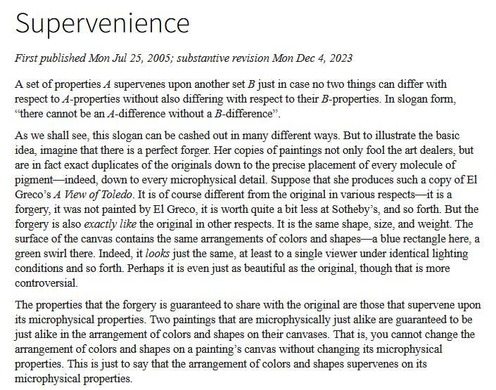
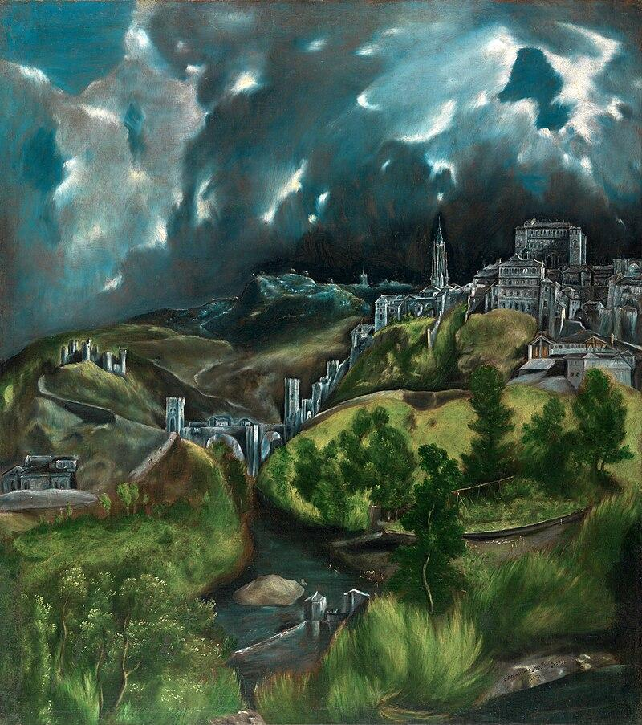

SEP provides a neat illustrative example that helps to grasp the notion of supervenience.

Vista de Toledo looks impressive, btw.

*Originally posted on [Mastodon](https://mastodon.social/@frimlat/114395974357417057).*
