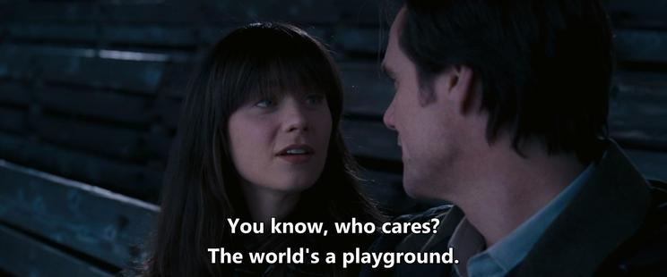
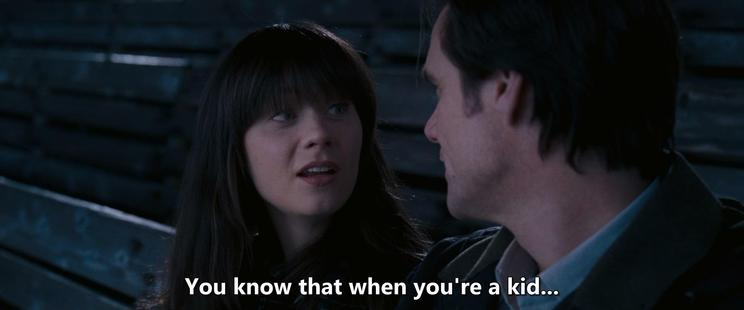
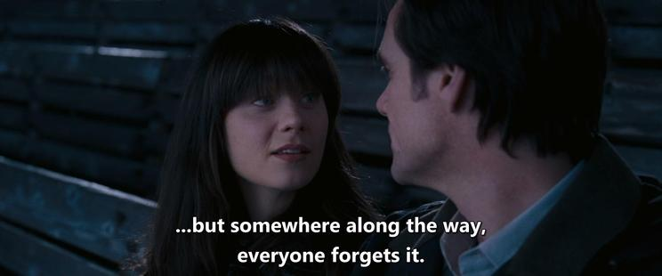

Today, I re-watched the Yes Man movie that I'd watched for the first time when I was a child. I didn't find it extremely funny, though. It's a pretty nice fable about connecting with one's own emotions and desires (with a little bit of getting carried away), with a simple message that you shouldn't refuse opportunities life offers you. Not a very deep thought, tbh, but one that’s worth reminding those stuck in a loop of routine, self-neglect, and self-detachment.

Btw, Jim Carrey looked attractive at 45 despite signs of age.

*Originally posted on [Mastodon](https://mastodon.social/@frimlat/114395605882064431).*
