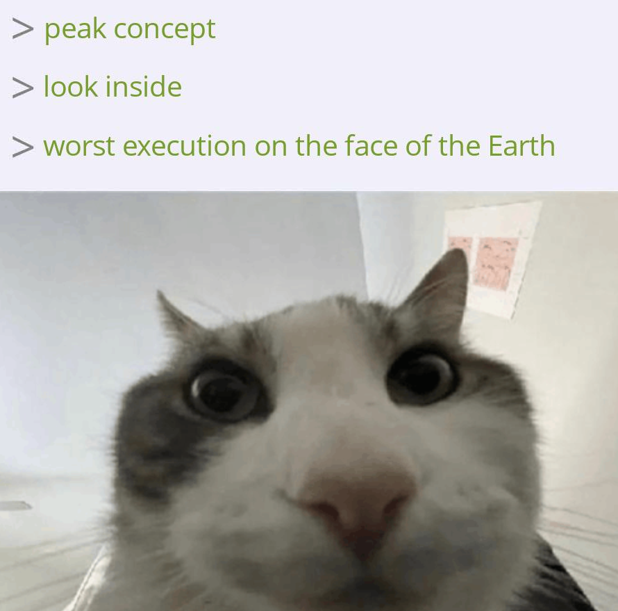
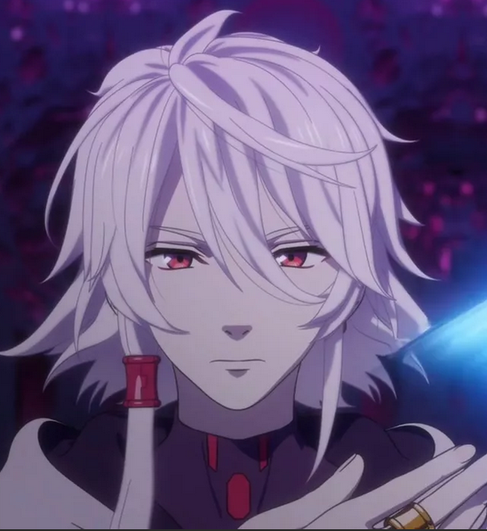

It's hard to accept that things I used to love have no appeal to me anymore. A few years ago, I could name Kado: The Right Answer among my favorite anime, though I had already noticed its many imperfections even then. Now, watching it, I mostly feel bored — partly because I remember it so well, but mostly because my perception has changed even more. The plot feels crude and logically flawed, the characters shallow, and the story full of clichés.

The idea is still great, but it’s sad that it didn’t get the implementation it deserves.

A silver lining: a new skill "Watching movies at 1.5x" unlocked.

*Originally posted on [Mastodon](https://mastodon.social/@frimlat/114450552120571909).*
