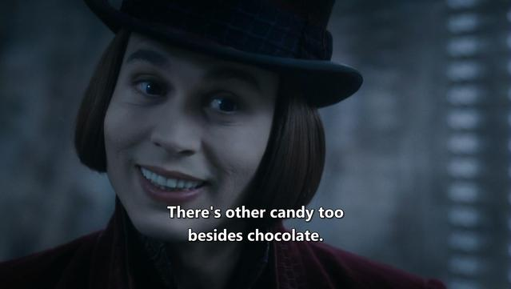

Things I’ve just learned from watching Charlie and the Chocolate Factory:

1. Having a family is good; having no family is bad. If you’ve had a conflict with your family in the past, just hug each other—and everyone will be happy. Ignore the fact that most families shown are utterly dysfunctional.
2. Being a greedy, spoiled child is bad, but producing goods with addictive properties has nothing to do with promoting unhealthy behavior.
3. If a deranged billionaire breaks the roof of your house with his airborne vehicle, never demand compensation— just go fix it with your family, because family is good (see 1).
4. If the same deranged billionaire puts children in mortal danger during a tour of his factory, don’t complain and don’t even try to leave before your own child becomes the next victim. Why bother? Just keep walking around with the man.
5. Sleeping under a broken roof in winter doesn’t harm your health in any way.

*Originally posted on [Mastodon](https://mastodon.social/@frimlat/114479866380822567).*
