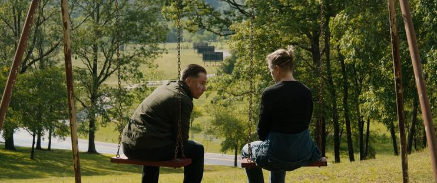

At last, a movie that wasn’t a total waste of time. I got interested in Three Billboards Outside Ebbing, Missouri when it came out two years ago… Wait, what, it was released in 2017? Never mind — I didn’t watch it then because I wasn’t in the right mood.

There are no heroes in the movie; every major character is flawed in their own way, and maybe that’s exactly what makes them relatable. Even the grieving mother Mildred turns out to be an imperfect parent with somewhat shady morals — not to mention the rude, aggressive cops.

However, the movie managed to make me sympathize with them and even shed a few tears over Willoughby’s death note — an unexpected reaction, given that he came across to me as a brute. And violent, impulsive Dixon’s emergence as more than just a stupid jerk caught me by surprise.

I’m not gonna watch Three Billboards Outside Ebbing, Missouri again, but I can definitely recommend seeing it at least once.

*Originally posted on [Mastodon](https://mastodon.social/@frimlat/114489423608680878).*
