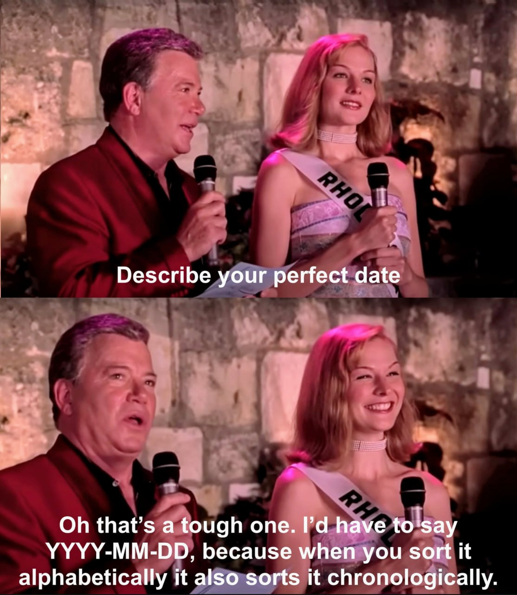

Кстати да. Не понимаю, почему большинство людей используют архаичный формат DD-MM-YYYY (про американцев вообще молчу, там форменное безумие). Вы время суток тоже задом наперед пишете?

*Впервые опубликовано в Telegram-канале «rompita spegulo».*
