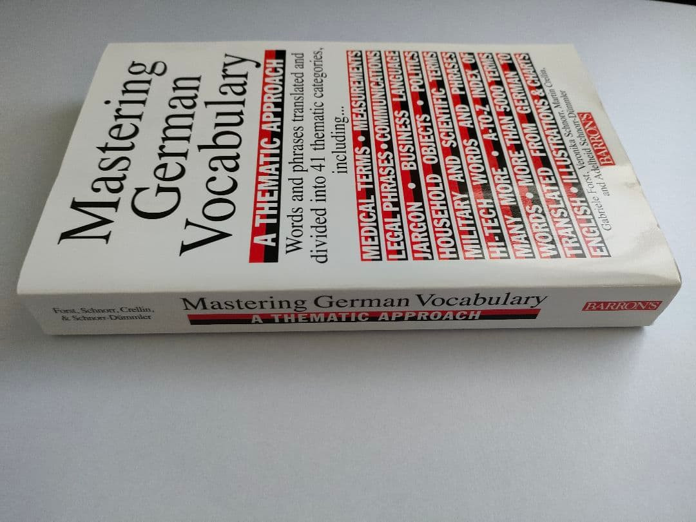
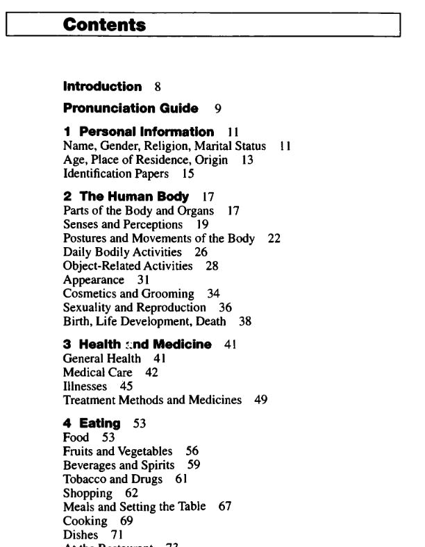
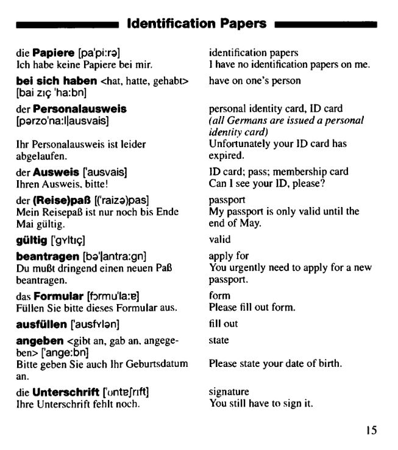

Нашел классный тематический словарь по немецкому. (Обожаю тематические словари и не понимаю, почему их так мало). Однако, есть нюанс. Книга издана в 1995 году, что означает 1) в словаре нет лексики, появившейся за прошедшие 30 лет; 2) слова в ней записаны по правилам орфографии до реформы 1996 года (например, Reisepaß вместо Reisepass). Но обе проблемы не очень серьезные, поэтому можно пользоваться, если не найду ничего лучше.

Угорел со слова Führerschein (водительские права).

