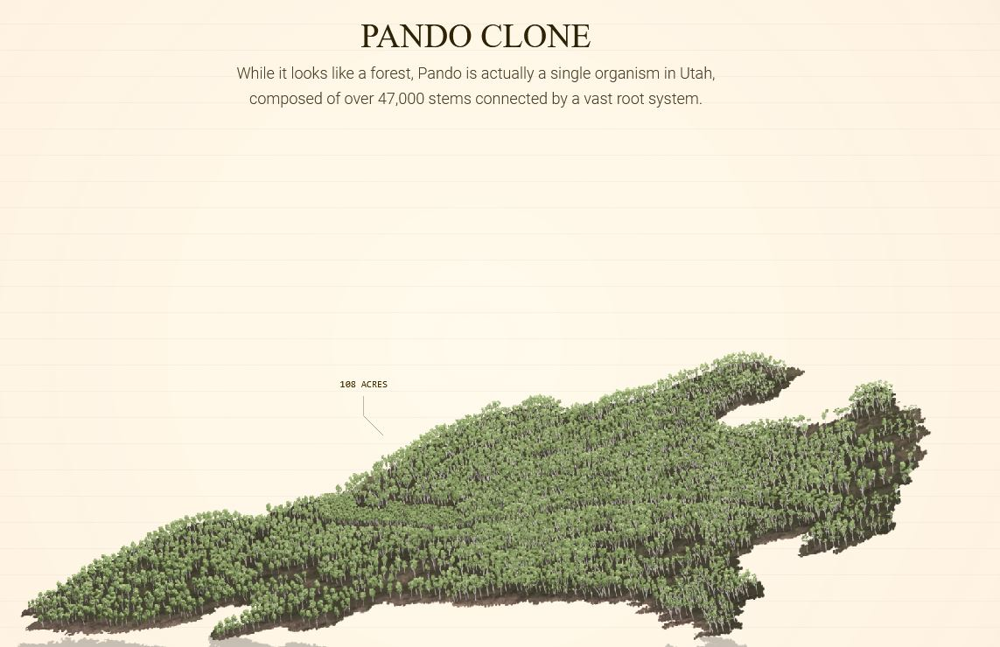
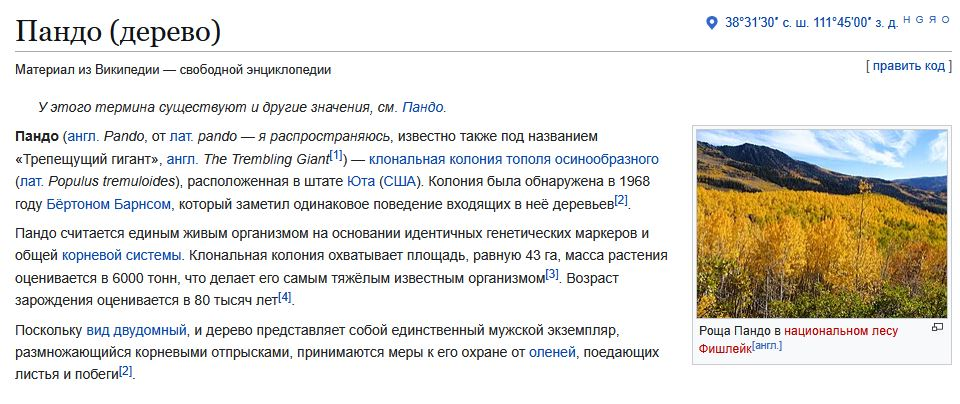

<https://neal.fun/size-of-life/>

OMG, мы живем на Вертумне?

[The confusing language of Pando: Rhizome, Trunk, Stem, Ramets, Suckers and Branches](https://www.friendsofpando.org/faqhowpandoworks/)
