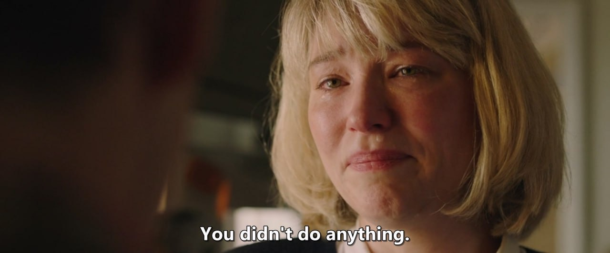

Устроил в выходные просмотр кино, что со мной бывает редко в последние годы.

Краткая сводка:

🟥 Resolution (2012). Попытка заставить друга-наркомана обратиться в rehab оборачивается мистическим хоррором. Начало показалось интересным, но концовку слили. Не понравилось.

🟨 Color Out of Space (2019). Экранизация Лавкрафта, которая по духу несколько напоминает мою любимую Аннигиляцию. Инопланетная хтонь устраивает биохоррор с мутациями на отдельно взятой ферме. В целом нейтрально-положительные впечатления, не жалею о потраченном времени, но Аннигиляция все равно осталась вне конкуренции. Аннигиляция ощущается как соприкосновение с чем-то чуждым человеческому разуму, как океан Соляриса, а здесь же больше ощущение, что зрителя просто стараются напугать.

🟨 Raw (2016). Про студентку-вегетарианку-ветеринара, которая пристрастилась к человеческому мясу. Если воспринимать историю буквально, то, имхо довольно скучновато и поверхностно. А если это "метафора взросления", как пишут в интернете, то сорян, но я ее не понял. Но один раз глянуть можно, если тема не вызывает отвращения. (Правда, наибольшее отвращение у меня вызвали не сцены с кровью, а все эти ритуалы инициации студентов с мощными вайбами дедовщины).

🟨 The Shining (1980). Наконец-то добрался до классики Кубрика. Вполне смотрибельно, хотя и несколько старомодно выглядит (что не удивительно, учитывая год выпуска). Но вот саундтрек... В лучших традициях 80-х и 90-х - громкий, дребезжащий, пронзительный, типа нагоняющий ужаса (у меня нагнал лишь раздражение).

🟩 Swallow (2019). Фильм очень понравился. История про девушку с реально существующим расстройством под названием "пика", которое заключается в навязчивом желании есть несъедобные предметы. Очень тронула история и вызвала большое сочувствие к героине. Хорошо могу понять ее желание ощутить хотя бы каплю контроля над своей жизнью. Затронуты социальные проблемы, токсичность в супружеских и детско-родительских отношениях, гендерные стереотипы и связанное с ними социальное давление. За эмоциями героини было реально интересно наблюдать (в отличие от Raw). Очень рекомендую.

