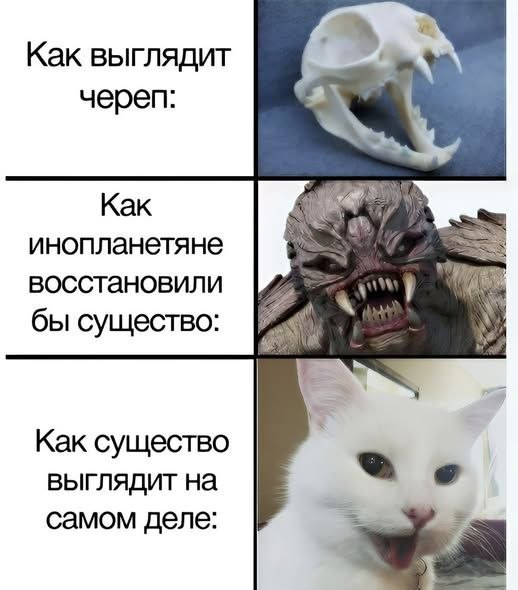
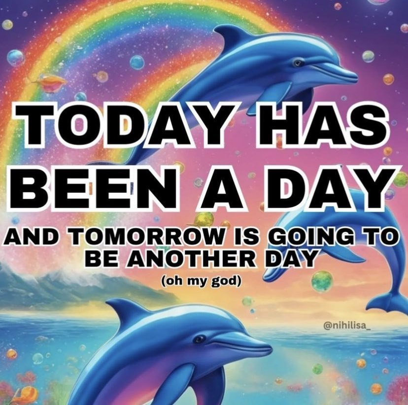
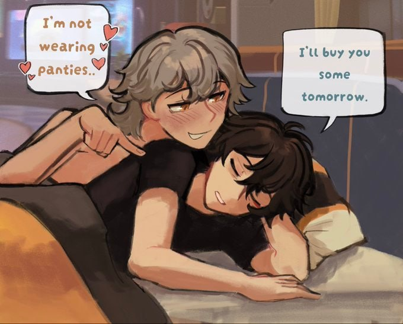
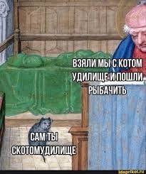

"Сегодня был день, и завтра будет еще один день (о боже)". Небольшая игра слов, т.к. Today has been a day означает, что день был тяжелый, но буквально - просто "был день".

\- Я без трусиков...\
\- Завтра куплю тебе.

Спасибо, я пополнил словарный запас

