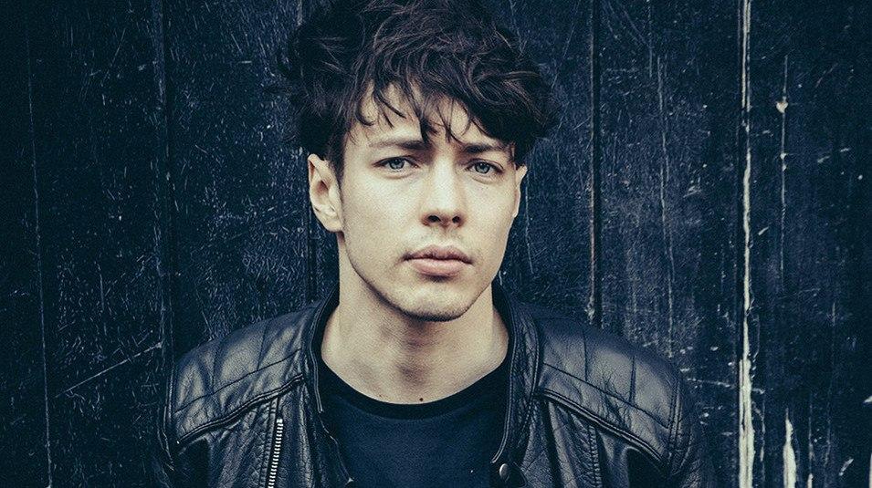
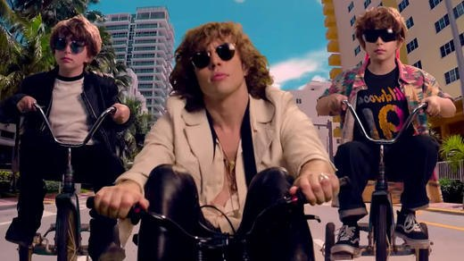
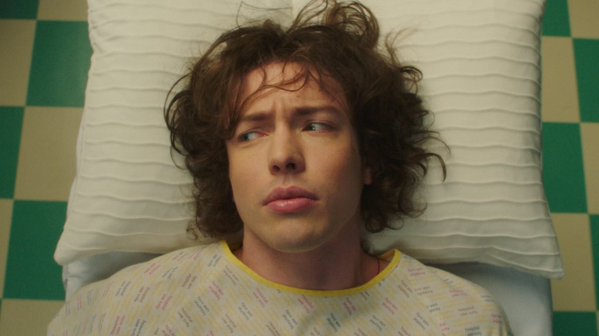

Barns Courtney - музыкальное открытие этого января. Все началось с краем глаза увиденного на экране жены AMV под его Glitter & Gold. Мне часто нравятся отдельные композиции разных исполнителей, но редко бывает так, чтобы понравилось чье-либо творчество в целом. Барнс Кёртни - приятное исключение из этого правила. В своей сольной карьере он выпустил пока всего два альбома - Attractions of Youth (2017) и 404 (2019), но учитывая, что он мой ровесник, хочется верить, что на этом все не закончится. Если, конечно, он не выпилится, как это случается с творческими людьми :)

Первое место в моем хит-параде занимает, безусловно, Kicks, и пополняет список любимых не только у Барнса, но и вообще. Эмоциональная песня которая прекрасно дополняется таким же эмоциональным клипом. Оффтоп: отдельные кадры и стиль съемки напомнили мой любимый Blood/Water от Grandson, хотя больше ничего общего у этих произведений нет.

Well I get my kicks,\
Take the money,\
I'll get my fix.

Второе место делят упорная и решительная Rather Die с ее шикарным вступлением, Fire с ее минималистичным и завораживающим клипом, энергично ностальгирующая "99" ("Nintendo, Atati. Sega's my Ferrari!") и ностальгирующая уже более меланхолично Little Boy. И на условное третье место отправляются Cannonball (безысходность detected), Hollow, You and I и другие. Впрочем, этот топ столь же зыбок, как мои оценки ароматов. Возможно, уже завтра он перетасуется; к тому же, не все песни Барнса я успел прочувствовать как следует - хотя бы потому, что некоторые из них я узнал только сегодня.

Клипы Барнса тоже достойны просмотра. Большинству их них характерен оттенок сюрреалистичности (хотя Golden Dandelions, пожалуй, в ней откровенно купается - did you get your fix that day, Barns? ;)).

Мой плейлист здесь: <https://open.spotify.com/playlist/5U3XrXbP4jbDdeNjEnQnSX>

*Впервые опубликовано в Telegram-канале «Walls inside us».*
