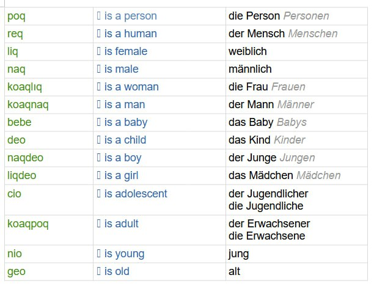
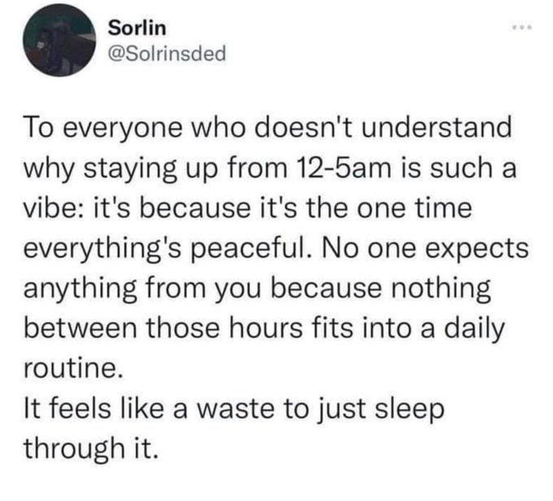

Чем заняться в 6 утра? Учить языки. Toaq (потенциально бесполезно) одновременно с немецким (потенциально полезно). Сова опять овладела мной ~~жестко и глубоко~~. За отсутствие ошибок в таблице не ручаюсь. И насчет множественного числа Jugendliche(r) и Erwachsene(r) я пока не понял, словарь показывает что-то странное. Будем изучать грамматику дальше, и однажды поймем.

*Впервые опубликовано в Telegram-канале «rompita spegulo».*
