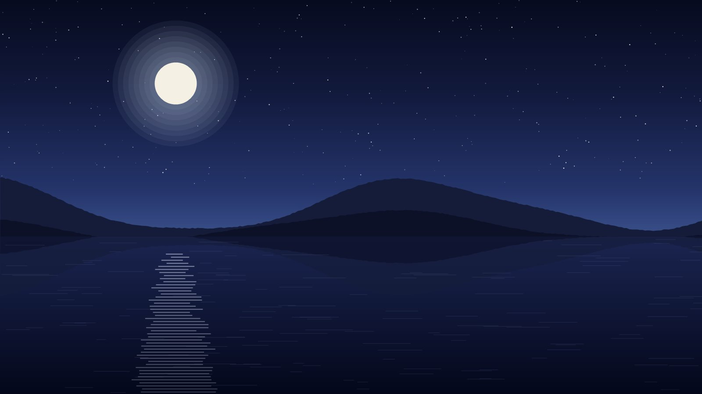

I'd been promising myself this loop since spring. In the end it took a free
weekend, a borrowed tent and a forecast that said *"clear, light winds"* to get
me out of the door.

<!--more-->

## The route

The loop starts at a small car park, climbs gently past Still Lake, and then
follows the ridge all the way to the summit before dropping back down the far
side. It's an easy two days, or one long one if you're in a hurry.



## The climb

The first hour is forest track, and then the trees thin out all at once and
you're on open hillside. From there the ridge is obvious: you just keep going up
until there's no more up.

A few things I noticed:

- The path is well marked until the last 200 m, where it splits into several
  sheep tracks. Any of them will do.
- There's no water above the lake. Fill up there.
- The wind on the summit was nothing like the forecast promised.

## Night at the lake

I camped on a flat shelf above the water. The moon came up just after eleven
and lit the whole valley — bright enough to read by, almost.

I did try a swim the next morning. It lasted about forty seconds.

## What I'd do differently

1. **Start earlier.** I reached camp with less than an hour of light left.
2. **Take a warmer sleeping bag.** September nights up there are not summer nights.
3. **Stay a second night.** The lake deserved more than one evening.



| Item              | Weight | Worth it?                  |
| ----------------- | -----: | -------------------------- |
| Tent (borrowed)   | 1.6 kg | Yes                        |
| Sleeping bag      | 1.1 kg | Needed a warmer one        |
| Stove and gas     | 0.4 kg | Yes — hot tea at the summit |
| Water filter      | 0.1 kg | Yes                        |
| Camera            | 0.7 kg | Mostly stayed in the bag   |


