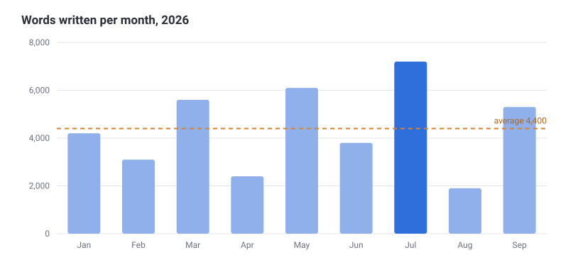

At the start of the year I began logging how many words I wrote each day —
notes, drafts, journal, everything except work email. Nine months in, here's
what the numbers look like.

<!--more-->

## The numbers

| Month     |  Words | Note                              |
| --------- | -----: | --------------------------------- |
| January   |  4,200 | New-year enthusiasm               |
| February  |  3,100 |                                   |
| March     |  5,600 | Started writing before breakfast  |
| April     |  2,400 | Two weeks of travel               |
| May       |  6,100 |                                   |
| June      |  3,800 |                                   |
| July      |  7,200 | Best month — long, quiet evenings |
| August    |  1,900 | Holiday, deliberately offline     |
| September |  5,300 |                                   |
| **Total** | **39,600** | **Average 4,400 per month**   |

## What I learned

**Mornings beat evenings.** The two best stretches (March and July) were both
when I wrote first thing, before opening any messages.

**Small days add up.** Most days were 100–200 words. The big months didn't
come from heroic sessions; they came from not skipping.

**Breaks are fine.** August was nearly empty, and September was one of the best
months. A rest seems to help more than it hurts.

## For the rest of the year

- [x] Keep logging daily
- [x] Write before breakfast on weekdays
- [ ] Reach 50,000 words by December
- [ ] Turn at least three notes from *growing* into *finished*
